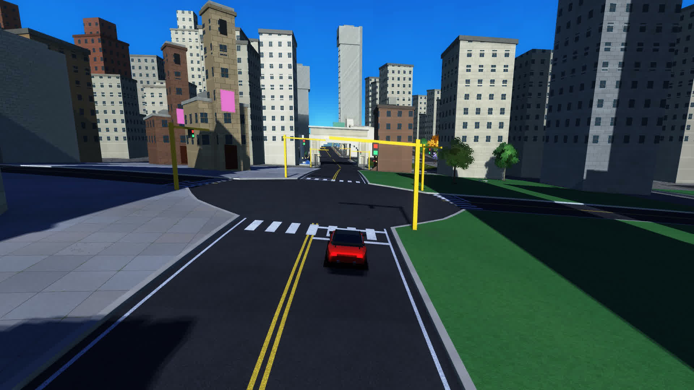
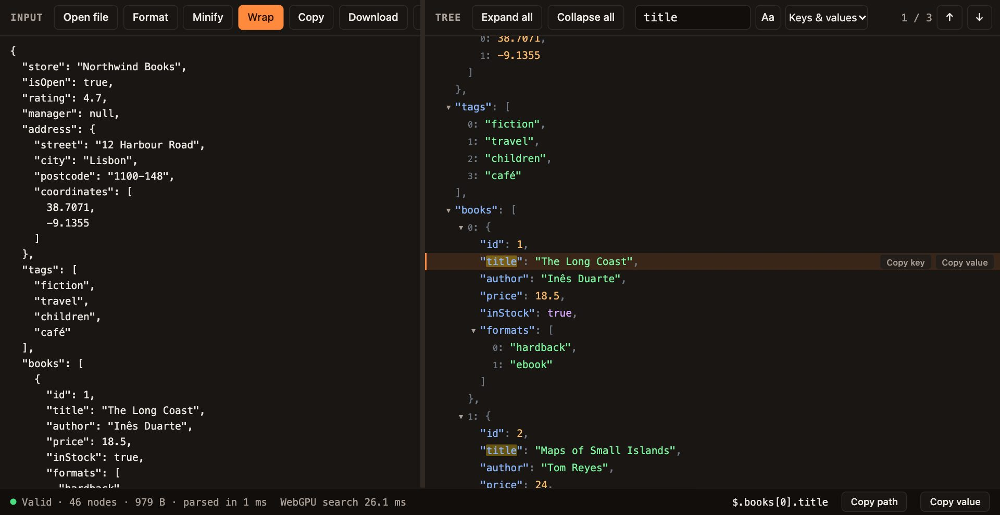

<h1 align="center">🧊 wgpu3d · gpuengine</h1>

<h3 align="center">Free, open-source WebGPU projects that run in your browser: a 3D game library, an open-world driving game, GPU-powered developer tools and a step-by-step WebGPU tutorial.</h3>

<p align="center">
  <a href="https://gpuengine.github.io/"></a>
  <a href="LICENSE"></a>
  
  
  
</p>

<p align="center">
  <b>🌐 Website: <a href="https://gpuengine.github.io/">gpuengine.github.io</a></b> ·
  <a href="https://gpuengine.github.io/site/wgpu3d/">wgpu3d library</a> ·
  <a href="https://gpuengine.github.io/site/games/city-drive/play/">Play City Drive</a> ·
  <a href="https://gpuengine.github.io/site/tutorials/">WebGPU tutorial</a> ·
  <a href="https://gpuengine.github.io/site/tools/">Developer tools</a> ·
  <a href="https://gpuengine.github.io/site/resources/">Official WebGPU resources</a>
</p>

<p align="center">
  <a href="https://gpuengine.github.io/site/games/city-drive/play/"></a>
</p>

**gpuengine** is a collection of free, open-source **WebGPU** projects at **[gpuengine.github.io](https://gpuengine.github.io/)**. Everything is plain **JavaScript and WGSL** with **nothing to install**: open a link and it runs on your GPU. It includes **wgpu3d**, a one-file **WebGPU 3D library** for scenes with drivable cars and walkable characters, **City Drive**, an **endless procedural open-world driving game**, a **JSON viewer that searches large files with a compute shader**, a **visual CSS editor**, a **WebGPU vs WebGL benchmark**, and a **12-lesson WebGPU tutorial** from your first triangle to shadow mapping.

## 📦 Projects

| Project | What it is | Links |
|---|---|---|
| 🧊 **[wgpu3d](https://gpuengine.github.io/site/wgpu3d/)** | A lightweight WebGPU 3D library in one ES module (about 49 KB, 17 KB gzipped): sun shadows, sky, fog, a mesh builder, cameras, keyboard and touch input, a car and a character you can control. | [Overview](https://gpuengine.github.io/site/wgpu3d/) · [Getting started](https://gpuengine.github.io/site/wgpu3d/getting-started/) · [API reference](https://gpuengine.github.io/site/wgpu3d/api/) · [Download](https://gpuengine.github.io/wgpu3d-0.1.0.min.js) · [Source](src/wgpu3d/) |
| 🚗 **[City Drive](https://gpuengine.github.io/site/games/city-drive/)** | A free browser driving game: an endless procedural city with traffic, overpasses, waterfronts, weather and time of day, streamed by Web Workers and rendered with WebGPU. | [Play](https://gpuengine.github.io/site/games/city-drive/play/) · [About the game](https://gpuengine.github.io/site/games/city-drive/) · [Source](site-src/pages/games/city-drive/play/) |
| 🔍 **[JSON Viewer & Editor](https://gpuengine.github.io/site/json-viewer/)** | Format, validate, minify, fold and edit JSON online. Searches keys and values in very large files on the GPU. Your data never leaves the browser. | [Open](https://gpuengine.github.io/site/json-viewer/) · [How the GPU search works](https://gpuengine.github.io/site/articles/gpu-text-search/) |
| 🎨 **[Visual CSS Editor](https://gpuengine.github.io/site/css-editor/)** | Drag handles and sliders to build box-shadow, gradients, clip-path, border-radius, filters, transforms, cubic-bezier easing and colours in HEX, RGB, HSL, HWB or OKLCH. | [Open](https://gpuengine.github.io/site/css-editor/) |
| 📊 **[WebGPU vs WebGL Benchmark](https://gpuengine.github.io/site/webgpu-benchmark/)** | Draw thousands of objects with WebGL2 and WebGPU, with and without instancing, and compare CPU time per frame and FPS on your own GPU. | [Run it](https://gpuengine.github.io/site/webgpu-benchmark/) · [Results article](https://gpuengine.github.io/site/articles/webgpu-vs-webgl/) |
| 📚 **[WebGPU Tutorial](https://gpuengine.github.io/site/tutorials/)** | Twelve short lessons, one idea each, from your first triangle to compute shaders, shadows and post-processing. Every example runs in an in-browser playground. | [Start](https://gpuengine.github.io/site/tutorials/webgpu-intro/) · [Playground](https://gpuengine.github.io/site/tutorials/playground/?example=first-triangle) |
| 📰 **[Articles](https://gpuengine.github.io/site/articles/)** | Long-form deep dives into how the game and tools work: procedural cities, world streaming, car physics, traffic, sun shadows and GPU text search. | [All articles](https://gpuengine.github.io/site/articles/) |

---

## 🧊 wgpu3d: a small WebGPU 3D library

**Make 3D browser games with WebGPU in a few lines of JavaScript.** wgpu3d is the rendering and driving code from City Drive, pulled out of the game and given a simple API. It is a **single ES module with no dependencies**, so there is no bundler, no npm install and no build step.

```html
<canvas id="scene" style="width: 100%; height: 480px"></canvas>
<script type="importmap">
  { "imports": { "wgpu3d": "https://gpuengine.github.io/wgpu3d-0.1.0.min.js" } }
</script>
<script type="module" src="game.js"></script>
```

```js
import { createApp, createCar, createGround, VehicleController } from "wgpu3d";

const app = await createApp({ canvas: document.querySelector("#scene"), environment: "sunset" });
app.add(createGround());

const car = createCar({ paint: "#1d6fd8" });
car.addBehavior(new VehicleController());
app.add(car);
app.follow(car);
app.start();
```

That is a complete program: a car on a field with sun shadows, a sky and a chase camera. Click the canvas and drive with WASD or the arrow keys, or drag on a phone.

**⬇️ Get it:** [`wgpu3d-0.1.0.min.js`](https://gpuengine.github.io/wgpu3d-0.1.0.min.js) · readable source in [`src/wgpu3d/`](src/wgpu3d/)

```bash
curl -LO https://gpuengine.github.io/wgpu3d-0.1.0.min.js
```

### What is in the box

| Feature | Details |
|---|---|
| **Renderer** | Sky gradient with a sun disc, soft sun shadow maps, sky and ground ambient light, glossy highlights, glowing surfaces, distance fog, 4× MSAA. Five lighting presets: morning, noon, sunset, dusk, night. |
| **Scene graph** | Objects with position, yaw, pitch, roll and scale, parent and child objects, tags, and behaviors that run every frame. |
| **MeshBuilder** | Boxes, cylinders, cones, spheres, tiled planes, lofts, triangles and quads, with per-vertex colour, gloss and glow. |
| **Playable objects** | A vehicle controller ported from City Drive's driving model, a character controller that walks, runs, jumps and stands on boxes, box and sphere collisions. |
| **Cameras** | A chase camera that trails a vehicle and an orbit camera you drag, pinch and scroll. |
| **Input** | Keyboard bindings plus a touch stick (drag to move, tap to jump) with no extra code. |
| **Prefabs** | The City Drive car, a character, trees, buildings, roads, crates, coins, lamp posts and ground. |

### wgpu3d tutorials

Each tutorial has a live demo running the exact code shown on the page.

| Tutorial | What you'll build |
|---|---|
| [Your first wgpu3d scene](https://gpuengine.github.io/site/wgpu3d/getting-started/) | Objects, meshes, materials, behaviors and an orbit camera in thirty lines |
| [Make a drivable car](https://gpuengine.github.io/site/wgpu3d/drive-a-car/) | A street with buildings and lamps, a car with arcade physics and a chase camera |
| [A tiny platform game](https://gpuengine.github.io/site/wgpu3d/collect-the-coins/) | Walk, run and jump onto crates to collect coins, with a score and a timer |
| [Build a procedural village](https://gpuengine.github.io/site/wgpu3d/procedural-village/) | Your own meshes with MeshBuilder, and a seeded generator that grows a new village every time |
| [API reference](https://gpuengine.github.io/site/wgpu3d/api/) | Every export, option and default |

---

## 🚗 City Drive: a free WebGPU driving game

**[▶ Play City Drive in your browser](https://gpuengine.github.io/site/games/city-drive/play/)**: no download, no plugin, no account.

An endless city, generated as you drive. Downtown towers give way to suburbs, parks and the waterfront, with live traffic on every street. City Drive is **plain JavaScript and WGSL with no engine or library underneath**. The world is a road graph that grows around the car; a **Web Worker** builds the buildings, trees and street furniture for each new block so the main thread only has to draw. Shadows come from a **sun shadow map**, and a **post-processing** pass finishes each frame.

| Key | Action |
|---|---|
| <kbd>W</kbd> / <kbd>↑</kbd> | Accelerate |
| <kbd>S</kbd> / <kbd>↓</kbd> | Brake and reverse |
| <kbd>A</kbd> <kbd>D</kbd> / <kbd>←</kbd> <kbd>→</kbd> | Steer |
| <kbd>Space</kbd> | Handbrake |
| <kbd>C</kbd> | Cycle camera: chase, action, hood, heli |
| <kbd>Z</kbd> / <kbd>X</kbd> | Auto-steer / cruise hold |
| <kbd>Q</kbd> / <kbd>E</kbd> | Turn left / right at the next junction |
| <kbd>B</kbd> | Change biome |
| <kbd>T</kbd> | Toggle traffic and people |
| <kbd>R</kbd> | Reset the car to the road |
| <kbd>F</kbd> / <kbd>Esc</kbd> | Enter / leave full screen |
| <kbd>H</kbd> | Hide the HUD |
| <kbd>M</kbd> | Sound on or off |
| <kbd>K</kbd> | Cool mode: 30 fps, lighter rendering |
| <kbd>V</kbd> / <kbd>N</kbd> | Start / stop recording a gameplay clip |

On a phone, swipe on the screen to steer and brake. It needs a browser with WebGPU: recent Chrome, Edge or Safari, or Firefox on Windows.

### How City Drive works

| Article | What it covers |
|---|---|
| [Building a procedural city in WebGPU](https://gpuengine.github.io/site/articles/procedural-city/) | A road graph that expands as you drive, blocks, districts, lots and junctions from one seed |
| [Streaming an open world with Web Workers](https://gpuengine.github.io/site/articles/streaming-world/) | A fixed pool of GPU vertex slots, a road-walking visibility search and geometry built off the main thread |
| [Car physics without a physics engine](https://gpuengine.github.io/site/articles/car-physics/) | Throttle, drag and steering maths, box collisions, road surfaces, driving assists and a chase camera |
| [Traffic simulation on a road graph](https://gpuengine.github.io/site/articles/traffic-simulation/) | AI cars that follow lanes, turn at junctions on Bézier curves and keep their distance |
| [Sun shadows, explained](https://gpuengine.github.io/site/articles/sun-shadows/) | One shadow map that follows the camera, texel snapping, lazy refresh, PCF and bias |

---

## 🛠️ Free developer tools that run in your browser

Private by design: every tool runs locally in the tab and nothing is uploaded.

| Tool | Use it to |
|---|---|
| [JSON Viewer & Editor](https://gpuengine.github.io/site/json-viewer/) | Validate JSON with exact line and column errors, format and minify without losing number precision, collapse, expand and edit nodes, search keys and values on the GPU, copy any key, value or path |
| [Visual CSS Editor](https://gpuengine.github.io/site/css-editor/) | Generate box-shadow, text-shadow, linear, radial and conic gradients, clip-path, border-radius, filters, transforms, cubic-bezier easing and colours, or paste existing CSS to edit it |
| [WebGPU vs WebGL Benchmark](https://gpuengine.github.io/site/webgpu-benchmark/) | Measure draw-call performance of WebGL2 and WebGPU on your own GPU |

<p align="center">
  <a href="https://gpuengine.github.io/site/json-viewer/"></a>
</p>

---

## 📚 Learn WebGPU step by step

A free **WebGPU tutorial for beginners**. Each lesson teaches one idea with a runnable example you can edit in the [playground](https://gpuengine.github.io/site/tutorials/playground/?example=first-triangle).

| # | Lesson | You'll learn |
|---|---|---|
| 1 | [What is WebGPU?](https://gpuengine.github.io/site/tutorials/webgpu-intro/) | The WebGPU API, how it compares to WebGL, browser support and feature detection |
| 2 | [Your first triangle](https://gpuengine.github.io/site/tutorials/first-triangle/) | Adapter, device, canvas context, WGSL shaders, render pipeline and render pass |
| 3 | [WGSL basics](https://gpuengine.github.io/site/tutorials/wgsl-basics/) | Types, vectors, structs, functions and passing data between shader stages |
| 4 | [Vertex buffers](https://gpuengine.github.io/site/tutorials/vertex-buffers/) | `createBuffer`, `writeBuffer`, vertex layouts, interleaved attributes, index buffers |
| 5 | [Uniforms & bind groups](https://gpuengine.github.io/site/tutorials/uniforms-bind-groups/) | `var<uniform>`, bind groups, per-frame animation, struct alignment and padding |
| 6 | [Camera & matrices](https://gpuengine.github.io/site/tutorials/camera-matrices/) | Model, view and projection matrices, perspective and lookAt, a spinning cube |
| 7 | [Depth buffer](https://gpuengine.github.io/site/tutorials/depth-buffer/) | `depth24plus` textures, depth testing and depth-stencil attachments |
| 8 | [Textures & samplers](https://gpuengine.github.io/site/tutorials/textures-samplers/) | `createTexture`, `copyExternalImageToTexture`, filtering, UVs and `textureSample` |
| 9 | [Instancing](https://gpuengine.github.io/site/tutorials/instancing/) | Thousands of objects in one draw call with `instance_index` and storage buffers |
| 10 | [Compute shaders](https://gpuengine.github.io/site/tutorials/compute-shaders/) | `@compute`, workgroups, storage buffers, `dispatchWorkgroups` and `mapAsync` readback |
| 11 | [Shadow mapping](https://gpuengine.github.io/site/tutorials/shadow-mapping/) | Depth from the light, comparison samplers, shadow acne, bias and PCF soft shadows |
| 12 | [Post-processing](https://gpuengine.github.io/site/tutorials/post-processing/) | Render to texture, greyscale, vignette, tone mapping and ping-pong blur passes |

---

## 🔗 Official WebGPU and GPU resources

The official specifications, documentation and tools for WebGPU and the GPUs it runs on, with a line on when each is useful. The same list, kept up to date, is on the website at **[WebGPU resources](https://gpuengine.github.io/site/resources/)**, and every tutorial lesson links to the matching MDN and specification pages.

### WebGPU and WGSL specifications

The standards every browser implements, written by the W3C GPU for the Web Working Group. When documentation disagrees, the specification is the final word.

| Resource | What it is for |
|---|---|
| [WebGPU specification](https://www.w3.org/TR/webgpu/) | The W3C standard for the WebGPU API: adapters, devices, buffers, textures, pipelines, passes and every validation rule. |
| [WGSL specification](https://www.w3.org/TR/WGSL/) | The WebGPU Shading Language standard: types, memory layout, address spaces, built-in values and functions. |
| [WebGPU editor's draft](https://gpuweb.github.io/gpuweb/) | The latest working version of the specification, updated as changes land, ahead of the published W3C version. |
| [WebGPU explainer](https://gpuweb.github.io/gpuweb/explainer/) | Why WebGPU is designed the way it is: security, portability, the object model and the reasoning behind each choice. |
| [GPU for the Web Working Group](https://www.w3.org/groups/wg/gpu/) | The W3C group that develops WebGPU and WGSL, with its charter, participants and publications. |
| [gpuweb on GitHub](https://github.com/gpuweb/gpuweb) | Where the specification is written: issues, proposals for new features and discussion with browser engineers. |

### Official WebGPU documentation

Reference and guides from browser makers and MDN, with an entry for every interface, method and dictionary in the API.

| Resource | What it is for |
|---|---|
| [MDN: WebGPU API](https://developer.mozilla.org/en-US/docs/Web/API/WebGPU_API) | Mozilla's reference for every WebGPU interface, with concepts, examples and browser compatibility tables. |
| [Chrome for Developers: WebGPU overview](https://developer.chrome.com/docs/web-platform/webgpu/overview) | Google's guide to WebGPU in Chrome: getting started, new features in each release and platform notes. |
| [From WebGL to WebGPU](https://developer.chrome.com/docs/web-platform/webgpu/from-webgl-to-webgpu) | Chrome's guide for WebGL developers: how contexts, buffers, uniforms, shaders and draw calls map to WebGPU. |
| [WebGPU troubleshooting tips](https://developer.chrome.com/docs/web-platform/webgpu/troubleshooting-tips) | Why navigator.gpu can be missing or requestAdapter can return null, and how to fix it in Chrome. |
| [WebGPU TypeScript types](https://github.com/gpuweb/types) | The official TypeScript definitions for WebGPU (@webgpu/types), maintained alongside the specification. |

### WebGPU browser support

WebGPU ships in Chrome, Edge and Safari, and in Firefox on Windows. These pages track exactly which versions and platforms support it.

| Resource | What it is for |
|---|---|
| [Can I use: WebGPU](https://caniuse.com/webgpu) | Browser and version support for WebGPU across desktop and mobile, with notes on flags and platforms. |
| [WebGPU implementation status](https://github.com/gpuweb/gpuweb/wiki/Implementation-Status) | The working group's own table of where each browser engine ships WebGPU and on which operating systems. |
| [WebGPU supported in major browsers](https://web.dev/blog/webgpu-supported-major-browsers) | web.dev's announcement of WebGPU shipping across Chrome, Edge, Firefox and Safari, with what it means for developers. |
| [Chrome ships WebGPU](https://developer.chrome.com/blog/webgpu-release) | The Chrome 113 release post that brought WebGPU to the stable web on Windows, macOS and ChromeOS. |
| [WebGPU Report](https://webgpureport.org/) | Shows your own browser's WebGPU adapter, features and limits, handy when a demo does not run on one machine. |

### Official samples and learning material

Runnable examples and guides written or reviewed by people who work on the specification and the browsers.

| Resource | What it is for |
|---|---|
| [WebGPU Samples](https://webgpu.github.io/webgpu-samples/) | The official sample collection: triangles, textured cubes, instancing, shadow mapping, compute particles, deferred rendering and more. |
| [Tour of WGSL](https://google.github.io/tour-of-wgsl/) | An interactive walk through the WGSL language, one feature per page, with code you can edit and run. |
| [WebGPU best practices](https://toji.dev/webgpu-best-practices/) | Practical advice from a WebGPU specification editor on buffers, bind groups, image uploads and error handling. |
| [WebGPU Fundamentals](https://webgpufundamentals.org/) | A widely used community tutorial series that explains WebGPU from first principles, with many live examples. |

### WebGPU implementations

The open-source engines inside the browsers. Both also run outside the browser, so WebGPU code ideas carry over to native apps.

| Resource | What it is for |
|---|---|
| [Dawn](https://dawn.googlesource.com/dawn) | The C++ WebGPU implementation used by Chrome and Edge, translating WebGPU to Vulkan, Metal and Direct3D 12. |
| [wgpu](https://github.com/gfx-rs/wgpu) | The Rust WebGPU implementation used by Firefox, also a popular native graphics library on every desktop and mobile platform. |

### The GPU APIs underneath WebGPU

WebGPU is modelled on modern native graphics APIs and runs on top of them. Their documentation explains what the GPU is actually doing.

| Resource | What it is for |
|---|---|
| [Vulkan](https://www.vulkan.org/) | Khronos' cross-platform GPU API, which WebGPU uses on Windows, Linux, Android and ChromeOS. |
| [Vulkan documentation](https://docs.vulkan.org/) | The Vulkan specification, guide and samples, useful for understanding pipelines, synchronisation and memory. |
| [Apple Metal](https://developer.apple.com/metal/) | Apple's GPU API, which WebGPU uses on macOS and iOS, with tools, sample code and performance guides. |
| [Direct3D 12 programming guide](https://learn.microsoft.com/en-us/windows/win32/direct3d12/directx-12-programming-guide) | Microsoft's guide to Direct3D 12, which WebGPU uses on Windows. |
| [WebGL](https://www.khronos.org/webgl/) | The Khronos home of WebGL, the browser graphics API that came before WebGPU. |
| [MDN: WebGL API](https://developer.mozilla.org/en-US/docs/Web/API/WebGL_API) | Mozilla's WebGL reference and tutorials, useful when porting older code to WebGPU. |
| [Khronos Group](https://www.khronos.org/) | The standards body behind Vulkan, OpenGL, WebGL, glTF and SPIR-V. |

### GPU vendor developer resources

Profilers, debuggers and performance guides from the companies that make the GPUs your WebGPU code runs on.

| Resource | What it is for |
|---|---|
| [NVIDIA Developer](https://developer.nvidia.com/) | NVIDIA's developer hub: graphics and compute documentation, SDKs and performance guides for GeForce and RTX GPUs. |
| [NVIDIA Nsight Graphics](https://developer.nvidia.com/nsight-graphics) | A frame debugger and profiler for Vulkan and Direct3D 12, the APIs WebGPU runs on in Chrome. |
| [AMD GPUOpen](https://gpuopen.com/) | AMD's open-source tools, libraries and in-depth articles on how Radeon GPUs execute shaders. |
| [Radeon GPU Profiler](https://gpuopen.com/rgp/) | AMD's low-level profiler that shows how each draw and dispatch occupies the GPU. |
| [Apple Metal documentation](https://developer.apple.com/documentation/metal) | Apple's Metal reference, including GPU capture and profiling in Xcode for Apple silicon. |

---

## ❓ WebGPU questions

<details>
<summary><b>Which browsers support WebGPU?</b></summary>

Recent versions of Chrome, Edge and Safari, and Firefox on Windows. Open [City Drive](https://gpuengine.github.io/site/games/city-drive/play/): if it runs, your browser has WebGPU. In code, wgpu3d's `isSupported()` tells you before you create a scene.
</details>

<details>
<summary><b>Is WebGPU faster than WebGL?</b></summary>

Usually, for scenes with many objects, because WebGPU lowers the cost of each draw call. The bigger change is compute shaders, which WebGL does not have. See the [measured results](https://gpuengine.github.io/site/articles/webgpu-vs-webgl/) and [run the benchmark](https://gpuengine.github.io/site/webgpu-benchmark/) yourself.
</details>

<details>
<summary><b>What can WebGPU be used for besides games?</b></summary>

Anything that benefits from parallel work: developer tools like the [GPU-accelerated JSON search](https://gpuengine.github.io/site/articles/gpu-text-search/), image and video filters, data visualization, physics simulation and running AI models in the browser.
</details>

<details>
<summary><b>Can I use wgpu3d in my own game?</b></summary>

Yes. wgpu3d is free software under GPL-2.0-or-later: use it, change it and share it, including in commercial projects, as long as what you distribute is shared under compatible terms and keeps the license header. Start with [your first wgpu3d scene](https://gpuengine.github.io/site/wgpu3d/getting-started/).
</details>

<details>
<summary><b>Do I need to install anything?</b></summary>

No. Every game, tool and tutorial runs in the browser tab, and the tools process your data locally.
</details>

---

## 🔎 Keywords

webgpu, wgsl, webgpu tutorial, learn webgpu, webgpu examples, webgpu 3d library, javascript 3d library, webgpu game engine, browser game engine, three.js alternative, lightweight 3d engine, webgpu shadows, shadow mapping, compute shaders, gpu compute, webgpu vs webgl, webgl2 benchmark, browser games, free online driving game, open world browser game, procedural city generation, procedural generation, road graph, traffic simulation, car physics, arcade vehicle physics, character controller, web workers, world streaming, json viewer, json editor, json formatter, json validator, large json viewer, gpu text search, css generator, box shadow generator, gradient generator, clip-path generator, cubic bezier editor, oklch color picker, free developer tools, webgpu specification, wgsl specification, webgpu documentation, mdn webgpu, webgpu browser support, webgpu samples, dawn, wgpu, vulkan, metal, direct3d 12, gpu programming, nvidia nsight, amd gpuopen, wgpu3d, gpuengine, city drive

---

## 📄 License

Copyright (C) 2026 Abhishek Sengar

wgpu3d, City Drive and the gpuengine website are free software: you can redistribute them and/or modify them under the terms of the **GNU General Public License, version 2 or (at your option) any later version** (`GPL-2.0-or-later`), as published by the Free Software Foundation.

They are distributed in the hope that they will be useful, but **without any warranty**, without even the implied warranty of merchantability or fitness for a particular purpose. See the [`LICENSE`](LICENSE) file for the full text.

Every wgpu3d and City Drive source file starts with the identifier `SPDX-License-Identifier: GPL-2.0-or-later`, and the bundled `wgpu3d-0.1.0.min.js` carries it in its header comment. The vendored [Lit](https://lit.dev/) runtime in `site-src/static/vendor/` keeps its own BSD-3-Clause license.
